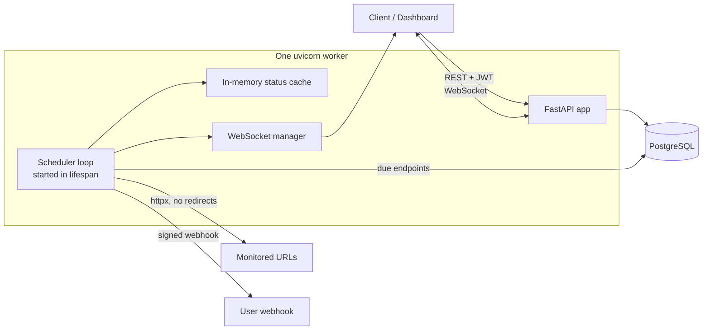

# API Uptime & Incident Monitor


A multi-tenant FastAPI backend that monitors your HTTP endpoints. Register a URL and a check interval, and a background scheduler pings it, records every result, opens an incident after consecutive failures, sends a signed webhook alert, and pushes live status over WebSocket.

## Features

- JWT auth with bcrypt hashing and rotating refresh tokens (reuse of a rotated token revokes all of that user's tokens)
- Endpoint CRUD scoped per user. Another user's endpoint always returns 404, never 403
- Per-endpoint check intervals (60 s to 24 h), per-user endpoint cap enforced inside a transaction
- Downtime confirmed only after 3 consecutive failures (configurable in code), so one network blip does not alert
- Incidents (opened on confirmed downtime, closed on recovery) and HMAC-signed webhook alerts
- Live dashboard over WebSocket: several connections per user, snapshot on connect, update on every ping
- History, uptime percentage (24h / 7d / 30d) and incident list per endpoint
- SSRF protection on every registered URL and every outbound request
- Rate limiting, request IDs, structured JSON access logs, consistent error shape, no stack traces to clients
- Daily retention job (deletes ping rows older than 30 days)

## Architecture



The scheduler is one asyncio task started in the FastAPI lifespan. Each tick it selects active endpoints whose `next_check_at` is due, pings them concurrently (capped), stores a `PingResult`, updates state, and schedules the next check from now plus the endpoint's own interval (with small upward jitter). Because `next_check_at` lives in the database, a restart does not burst-fire missed checks.

## Quick start (Docker)

```bash
git clone https://github.com/Sanjay-jat/api-uptime-monitor.git
cd api-uptime-monitor
cp .env.example .env
```

Edit `.env` and set `JWT_SECRET` to a random value of at least 32 characters. Then:

```bash
docker compose up --build -d api
curl localhost:8000/health
```

Interactive API docs: http://localhost:8000/docs

`docker compose` starts Postgres and the API. The container runs `alembic upgrade head` on start, then uvicorn with one worker.

## Configuration

Settings come from environment variables (see `.env.example`).

| Variable | Purpose |
|---|---|
| `DATABASE_URL` | Postgres URL (asyncpg). Compose overrides the host for the api container |
| `TEST_DATABASE_URL` | Tests only. Optional: the app and the Docker image start without it |
| `JWT_SECRET` | Signing key, at least 32 characters, no default |
| `JWT_ALGORITHM` | Default `HS256` |
| `ACCESS_TOKEN_MINUTES` / `REFRESH_TOKEN_DAYS` | Token lifetimes (15 min / 7 days) |
| `CORS_ORIGINS` | JSON list of allowed browser origins |

## API overview

| Area | Routes |
|---|---|
| Auth | `POST /auth/register`, `POST /auth/login`, `GET /auth/me`, `POST /auth/refresh`, `POST /auth/logout` |
| Webhook | `PUT /auth/me/webhook` (returns the signing secret once), `DELETE /auth/me/webhook` |
| Endpoints | `POST /endpoints`, `GET /endpoints`, `GET/PATCH/DELETE /endpoints/{id}` |
| History | `GET /endpoints/{id}/pings`, `/uptime?window=24h\|7d\|30d`, `/incidents` |
| Live | `WS /ws/dashboard` (first message must be `{"token": "<access token>"}`) |

Webhook requests carry the header `X-Signature: sha256=<hex>`, an HMAC-SHA256 of the raw body with your webhook secret. The body includes a timestamp (`at`); replay protection is the receiver's job.

## Running the tests

```bash
docker compose up -d db_test
pip install -e ".[dev]"
pytest -q
```

With coverage: `pytest -q --cov=app --cov-report=term-missing`

The suite has unit tests (state machine, SSRF validator with Hypothesis, uptime math), integration tests against a real Postgres test database (auth, ownership, scheduler with mocked HTTP, WebSocket, rate limits, errors, CORS) and a regression file with one test per fixed bug. CI runs two jobs. `check`: lint, migrations on an empty database, the full suite and a coverage gate of 90%. `docker`: builds the image and imports the app inside it with no test database URL, which catches missing runtime dependencies.

## Security notes

- SSRF: a URL is checked at registration and again before every ping and every webhook. Only http/https, no userinfo, every resolved IP must be public (IPv4 and IPv6), redirects are never followed.
- Passwords: bcrypt. Refresh tokens: stored as SHA-256 hashes, rotated on use.
- Errors never expose stack traces or echo user input. A request ID is returned in `X-Request-ID`.
- The httpx INFO log is silenced because it prints full URLs, which can contain secrets in query strings.
- Rate limits (in memory): register and login 5 per minute per IP; create endpoint, update endpoint and set webhook 10 per minute per user.

## Design decisions

- **One uvicorn worker, in-memory cache and WebSocket manager.** Keeps the scheduler from running twice and keeps live updates correct without Redis.
- **Scheduler is an asyncio loop, not a library.** Fewer dependencies. State lives in the database.
- **Retry logic is a pure function** (`next_state`), so it is unit-tested without I/O or clocks.
- **Offset pagination** on history lists. Simple; keyset pagination is the upgrade.
- **Uptime percentage is a SQL aggregate** over the window. No rollup tables until the data needs them.

## Known limitations

- Run exactly one worker. Two workers would ping every endpoint twice and split WebSocket clients. Upgrade path: Redis (pub/sub, rate-limit store, cache) plus a leader lock.
- The rate limiter is in memory. Behind a reverse proxy all users can share one IP unless forwarded headers are handled.
- Access tokens stay valid until they expire (up to 15 minutes) after logout, and a WebSocket stays open after its token expires. The token is checked only at connect.
- The status cache is empty after a restart until each endpoint's next ping, so the first snapshot can be empty.
- No heartbeat on WebSockets and no cap on sockets per user.
- DNS rebinding: the URL is re-validated before each request, but httpx resolves the name again when it connects. Pinning the resolved IP in the transport would close this window.
- One slow ping (timeout up to 30 s) delays the whole tick. Broadcast and webhook sends are awaited inline.
- Webhook alerts are one attempt, no retry, no cooldown. The webhook secret is stored in plain text.
- A webhook send (up to 10 s) holds a database connection while it runs.
- The `refresh_tokens` table is never cleaned. Expired and revoked rows stay.
- Migrations run on container start, which is fine for one container and racy for several.
- No rate limit on `POST /auth/refresh`. Refresh tokens are 256-bit random values, so guessing is not practical.
- `429` responses have no `Retry-After` header.
- The request ID appears in the access log and in 500 responses only, not in scheduler or alert logs. CORS preflight responses have no `X-Request-ID`.
- The WebSocket has no Origin check. It authenticates with a first-message token, not a cookie.
- Unauthenticated WebSocket connections are not capped. Each waits at most 10 s for the token.
- No pagination on `GET /endpoints` (capped at 10 per user).
- No performance benchmarks have been run, so none are claimed.